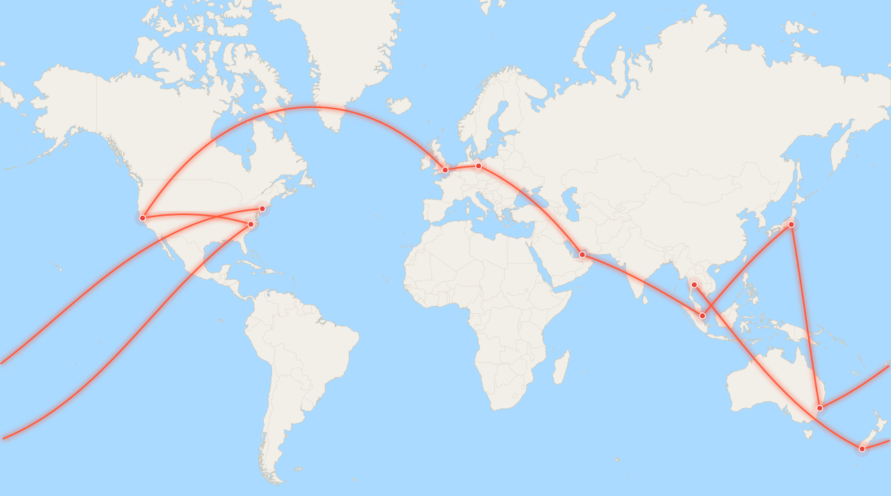

# gmap-timeline-replaysvg

Turn a Google Maps **Timeline** export into a **city-level world map SVG** you can
put in a profile README. Four looks, all from the same city-level data:

| Mode | What it does |
| --- | --- |
| **static** | dots on a world map |
| **animated** | a glowing dash ping-pongs along great-circle arcs, one hop at a time |
| **drift** | the flat map slowly pans a full width and repeats |
| **globe** | an orthographic globe whose camera follows the route, routes drawn on the sphere |

Everything runs locally. The only thing the tool ever writes is a small JSON
file of **city names and gazetteer city centres** plus the SVGs drawn from it.

<picture>
  <source media="(prefers-color-scheme: dark)" srcset="examples/worldmap-animated-dark.svg">
  
</picture>

<sub>[Example data](examples/demo-places.json) is a fictional tour, not a real
person's history. More variants: [static light](examples/worldmap-light.svg) ·
[static dark](examples/worldmap-dark.svg) ·
[drift](examples/worldmap-drift-light.svg) ·
[rotating globe](examples/worldmap-globe-light.svg) ·
[globe, dark](examples/worldmap-globe-dark.svg).</sub>

## Use it on your phone

Open **https://github.tig.pw/gmap-timeline-replaysvg/**
(also **https://kaovilai.github.io/gmap-timeline-replaysvg/**).

1. Export Timeline from the Maps app (steps below) and keep the `.json` or
   `.zip` in your phone's Files app.
2. Tap **Choose Timeline export** and pick it. Parsing and drawing happen in the
   browser; the file never leaves the device.
3. Switch between **Flat map** and **Globe** to preview both; the globe is
   interactive (drag to spin). Download any of the SVGs, or **Download GIF** to
   render an animated GIF of the globe in the browser — the encoder is bundled,
   so no upload and no dependencies. Everything lands in Files.
4. Upload them to your profile repo from GitHub's mobile site, then paste the
   README snippet the page gives you.

The page is a PWA: **Add to Home Screen** on a phone (or **Install app** on
desktop) gives it an icon, a standalone window and offline use after the first
visit. Updates need no action: assets are fetched network-first, so the next
load picks up newly posted files, and if a new service worker lands while the
app is open a banner offers a one-tap reload.

The page uses the same JavaScript renderer that is verified byte-for-byte
against the Python CLI in CI (`tests/parity.mjs`), so a map produced on the
phone is identical to one produced on a laptop.

## Why

Google retired the cloud copy of Timeline in 2024; the history now lives on the
phone and is only available through the export inside the Maps app. This tool
consumes that export directly and reduces it to city level before anything is
published, so the map stays useful without publishing precise locations,
addresses or place names.

## Get your export

**Android**: open the phone's **Settings** app → **Location** → **Location
services** → **Timeline** → **Export timeline data**. (Some Maps versions expose
the same button at profile picture → **Your Timeline** → ⋮ → **Location and
privacy settings**.) The file is `Timeline.json`.

**iPhone / iPad**: **Google Maps** → profile picture → **Settings** → **Location
& Privacy** → **Export Timeline data** → **Save to Files**. The file is
`location-history.json`.

There is no web deep link into that screen — Android's system settings can't be
opened from a page, and iOS has no settings URL — so the page links Google's
per-platform help article and Takeout instead.

Older Google Takeout archives work too: `Records.json`, `Location History.json`
and `Semantic Location History/YYYY/*.json`.

> [!IMPORTANT]
> Never commit the raw export. The `.gitignore` here covers the usual filenames,
> but keep the file outside any repository anyway.

## Quick start

No third-party packages are required (Python 3.8+):

```sh
python3 -I -B worldmap.py all ~/Downloads/Timeline.json
```

This writes `places.json` and eight SVGs (each mode in light and dark) into the
current directory:

- `worldmap-light.svg`, `worldmap-dark.svg` — static
- `worldmap-animated-*.svg` — animated
- `worldmap-drift-*.svg` — drifting pan
- `worldmap-globe-*.svg` — baked rotating globe

Then point your profile README at the animated pair:

```html
<picture>
  <source media="(prefers-color-scheme: dark)" srcset="worldmap-animated-dark.svg">
  
</picture>
```

Generating directly into an existing profile checkout:

```sh
python3 -I -B path/to/worldmap.py all ~/Downloads/Timeline.json \
  --data-dir path/to/profile/data \
  --out-dir path/to/profile
```

## What "city level" means

Every sample in the export — visit, activity endpoint, path point or raw signal —
is resolved to the nearest populated place in a vendored Natural Earth gazetteer
(7,342 places worldwide). `places.json` then stores only:

- gazetteer city name, region, country and ISO code;
- the **city centre** coordinates from the gazetteer, rounded to ~1 km — never
  the original sample;
- visit count, distinct days, and first/last year.

Raw coordinates, addresses, place names/IDs and exact timestamps are discarded
during import and never written to disk. The test suite asserts that none of
them can appear in the output.

Samples farther than `--max-city-km` (default 75 km) from any populated place
are dropped; position/path samples use the tighter `--max-path-km` (default
25 km) so a highway drive does not snap to a town 70 km away.

### Dates

Even a year is a hint about when you were somewhere. `--dates` controls what
`places.json` says:

| Value | What is written |
| --- | --- |
| `real` (default) | first and last visit **year** per city |
| `synthetic` | no years; each city gets a fake `first_day`/`last_day` (same day) exactly one day after the previous city in route order, starting at `--date-base` (default `2000-01-01`) |
| `none` | no date fields at all |

Synthetic dates keep the animated route in chronological order while publishing
nothing real about timing — the recommended mode for a public profile repo.
The browser page exposes the same choice ("Dates in places.json").

```sh
python3 -I -B worldmap.py import ~/Downloads/Timeline.json \
  --dates synthetic --out data/places.json
```

## The animated variant

- Faint **great-circle arcs** connect cities in chronological order (by first
  visit year), so the route reads as travel rather than straight map lines.
- A glowing dash **ping-pongs** along the arcs, one hop at a time: forward
  through the years, then backward. Each city's halo flares as the comet
  arrives.
- Pure inline CSS and SVG filters — no scripts, no external references — so it
  animates as an `` in a README.
- All motion is inside `@media (prefers-reduced-motion: no-preference)`;
  reduced-motion readers get the still map.
- Output is deterministic: the same `places.json` renders byte-identical SVGs.

The drift variant tiles the map twice so the pan has no seam. The globe bakes
frames into a single SVG, each sampled along the route so the camera follows the
moving point and keeps the dots in view (latitude is clamped to ±38° so the
poles never distort); the frames play forward, then backward, so the loop
returns to the first city without a jump. A README image cannot run scripts, so
the motion has to be pre-rendered.

### Globe smoothness (FPS)

Playback is `frames / (duration / 2)` frames per second, because half the cycle
is the return trip. Each frame repeats the coastline, so file size grows almost
linearly — roughly 26 kB per frame at 640 px. `--globe-fps` derives the frame
count for you:

```sh
python3 -I -B worldmap.py render places.json --globe-fps 10 --globe-duration 24
```

| Target | Frames | Approx. SVG size (640 px) |
| --- | --- | --- |
| 2 fps (default) | 24 | 630 kB |
| 6 fps | 72 | 1.9 MB |
| 10 fps | 120 | 3.1 MB |
| 15 fps | 180 | 4.7 MB |

Half the width roughly halves the bytes: 320 px at 15 fps is ~2.3 MB. For motion
that actually looks smooth, prefer the GIF export below or the live browser
globe (60 fps).

Tuning: `--duration 120` slows the animated cycle (default 90 s), `--no-animated`,
`--no-drift` and `--no-globe` skip variants, `--theme dark` renders one theme.

## Commands and flags

```sh
# import only: export -> places.json (PII stripped)
python3 -I -B worldmap.py import ~/Downloads/Timeline.json

# render only: places.json -> SVGs
python3 -I -B worldmap.py render places.json

# both
python3 -I -B worldmap.py all ~/Downloads/Timeline.json
```

| Flag | Default | Meaning |
| --- | --- | --- |
| `--out` | `places.json` | where `import` writes the city-level JSON |
| `--data-dir` | `.` | where `all` writes `places.json` |
| `--out-dir` | `.` | where SVGs are written |
| `--max-city-km` | `75` | visit cutoff from the nearest populated place |
| `--max-path-km` | `25` | cutoff for dense position/path samples |
| `--min-visits` | `1` | drop cities with fewer visits |
| `--dates` | `real` | `real`, `synthetic` (fake days one apart) or `none` |
| `--date-base` | `2000-01-01` | first synthetic day |
| `--theme` | `both` | `light`, `dark` or `both` |
| `--width` | `1280` | SVG width in pixels |
| `--duration` | `90` | seconds per ping-pong cycle |
| `--no-animated` | off | skip animated variants |
| `--no-drift` | off | skip drift variants |
| `--no-globe` | off | skip globe variants |
| `--globe-width` | `640` | globe SVG width |
| `--globe-frames` | `24` | baked rotation frames |
| `--globe-fps` | off | derive frames from fps and `--globe-duration` |
| `--globe-duration` | `24` | seconds per forward-and-back globe cycle |

## GIF export

For sharing outside a README (Slack, a blog, a slide), render the same
route-following globe to a high-resolution GIF:

```sh
python3 -m pip install pillow   # only the GIF command needs it
python3 -I -B worldmap.py gif places.json --out travel.gif \
  --width 1080 --fps 20 --duration 24 --theme dark
```

- `--width` is the output width; frames are supersampled 2× before downscaling,
  so 1080 is crisp on retina screens (`--supersample` to change).
- `--fps` sets the playback rate, capped at **50**: GIF stores frame delays in
  hundredths of a second, and browsers clamp anything under 20 ms up to 100 ms,
  so 2 cs (50 fps) is the format's hard ceiling. True 60 fps needs video — the
  browser page records the live globe to WebM.
- `--colors` (default 256) trades palette fidelity for file size; 128 roughly
  halves the bytes. `--dither` adds Floyd–Steinberg dithering, which smooths the
  ocean gradient at the cost of a noticeably larger file — flat colours are
  clean without it.
- Frames = `fps × duration / 2` forward, then reversed for a seamless loop.
- 640 px / 12 fps / 24 s produces 286 frames and a ~7 MB GIF in about six
  seconds. 1080 px / 20 fps is around 30 MB.

The GIF uses the same palette across frames. There is little inter-frame
saving to be had: the camera follows the route, so almost every pixel changes
each frame and size scales with the frame count. Budget roughly 85 kB per
720 px frame — 50 fps × 30 s is ~132 MB, past GitHub's 100 MB file limit.
Practical long loops drop to 25 fps and 128 colours (~61 MB raw), then
`gifsicle -O3 --lossy=80` brings a 30 s / 720 px loop to ~43 MB; that is what
the profile-README workflow does.

The browser page does the same thing without Pillow: `js/gif.js` is a small
GIF89a encoder (median-cut palette, LZW, animation) that renders the globe from
the canvas, so you can produce a GIF on the phone with no upload. Pick the
width, fps (up to 50), length, colour count and dithering on the page.

## Basemap data

`data/` holds public-domain [Natural Earth](https://www.naturalearthdata.com/)
data: a simplified 1:50m coastline (1:110m for the globe), country borders, and
populated places used for city lookup. Refresh it with:

```sh
python3 -I -B build-mapdata.py
```

## Tests

```sh
python3 -I -B tests/test_worldmap.py
```

They cover every supported export shape, coordinate parsing, PII stripping,
same-name cities, high-latitude/antimeridian lookups, deterministic rendering,
the animated/globe files being self-contained, and staleness between
`examples/demo-places.json` and the committed example SVGs.

`node tests/parity.mjs` renders all eight examples with the browser module and
asserts the bytes match the Python CLI, so a map made on the phone is identical
to one made on a laptop. `node tests/pwa.mjs` checks that every path the service
worker precaches exists and that the manifest icons resolve, so an installable
build cannot silently break. CI runs all three suites on every push.

## License

Code and generated examples: CC BY 4.0, see [LICENSE](LICENSE). Natural Earth
data is public domain.
